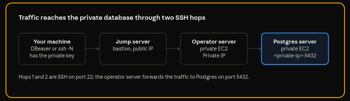

# Connecting to Postgres Database (DBeaver & SSH Tunnel)

## Overview

The Postgres server is private, so every connection goes through a jump server (public IP) and an operator server (private EC2) first.



DBeaver builds this tunnel itself; without DBeaver you build the same tunnel with `ssh -N` and connect to a local port.

## Current setup in DBeaver

DBeaver connects to the database through its built-in SSH tunnel, which hops through the jump server and the operator server. The connection is named `postgres_db`.

#### Main tab (database connection)

| Field | Value |
| --- | --- |
| Connect by | Host |
| Host | `<db-server-private-ip>` |
| Port | `5432` |
| Database | `postgres_db` |
| Authentication | Username/password |
| Username | `postgres-user` |
| Password | Stored in DBeaver ("Save password" ticked); get it from the team's secret store |

### SSH tab (tunnel)

#### Jump servers (SSH tab)

| Order | Host | User | Authentication |
| --- | --- | --- | --- |
| Jump #1 | `<bastion-server-public-ip>:22` | `fahad` | Public Key |
| Target | `<operator-server-private-ip>:22` | `fahad` | Public Key |

DBeaver opens the SSH connection to the bastion, then to the operator server, and forwards the Postgres port to `<db-server-private-ip>:5432`.

## Without DBeaver: SSH tunnel from `~/.ssh/config`

If you don't use DBeaver, define the same two-hop tunnel in your SSH config, start it, and connect to the database through a local URL.

1. Add this to `~/.ssh/config`:

```
Host bastion-server
  HostName <bastion-server-public-ip>
  User fahad
  IdentityFile /home/fahad/Documents/keypair/id_ed25519

Host db-tunnel
  HostName <operator-server-private-ip>
  User fahad
  IdentityFile /home/fahad/Documents/DB_Keys/bastion-server-private-key
  ProxyJump bastion-server
  LocalForward 5432 <db-server-private-key>:5432
```

2. Start the tunnel and leave the terminal open:

```bash
ssh -N db-tunnel
```

3. Connect to the database through the local end of the tunnel. Any client or application can use this URL:

```
postgresql://postgres-user:<password>@localhost:5432/postgres_db
```

For a GUI client, use host `localhost`, port `5432`, database `postgres_db`, user `postgres-user`.

### How the config maps to the DBeaver setup

| DBeaver | SSH config |
| --- | --- |
| Jump #1 (`<bastion-server-public-ip>`) | `Host bastion-server` and `ProxyJump bastion-server` |
| Target (`<operator-server-private-ip>`) | `Host db-tunnel` |
| Database host and port (`<db-server-private-ip>:5432`) | `LocalForward 5432 <db-server-private-ip>:5432` |
| Private key | `IdentityFile` |

## Troubleshooting and security notes

- **Tunnel won't start:** run `ssh -vN db-tunnel` to see which hop fails (bastion or operator server).
- **Key not offered to the bastion:** load it with `ssh-add /home/fahad/Documents/DB_Keys/bastion-server-private-key`.
- **Connection refused on `localhost:5432`:** the tunnel is not running; start it again and keep the terminal open.
- **Port already in use:** change the local port in `LocalForward` and in the connection URL.
- **Keep the private key private:** it must stay on your machine with permissions `600` (`chmod 600 /home/fahad/Documents/DB_Keys/bastion-server-private-key`).
- **Don't paste the database password into chats or documents:** store it in the team's secret store and rotate it if it was shared.